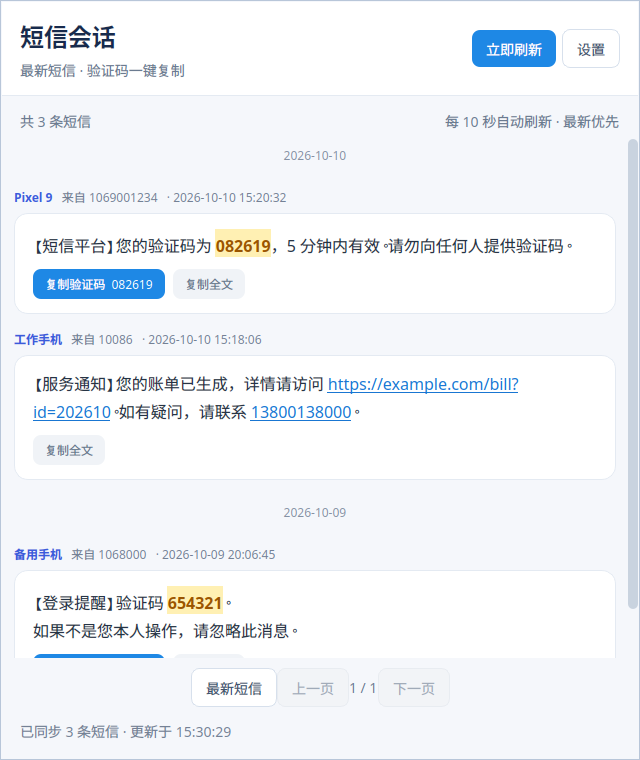

# Ubuntu 短信会话客户端

使用 Python + PySide6 开发，读取现有 PHP 短信转发服务器。界面参考 `PHP/smslist.php` 的日期分组和短信气泡。

## 启动

### 使用 Debian 安装包

已构建的包位于 `dist/sms-forward-client_1.0.3_all.deb`。在包所在目录执行：

```bash
sudo apt install ./sms-forward-client_1.0.3_all.deb
```

安装后可在 Ubuntu 应用菜单打开“短信会话”，或运行：

```bash
sms-forward-client
```

安装包使用系统仓库中的 PySide6 6.6+ 模块，由 `apt` 安装依赖，适用于当前 Ubuntu 26.04。其他发行版需要仓库提供包中声明的依赖。纯 Python 应用本体采用 `all` 架构，未内置 Qt 二进制。用户配置和 Token 不打入安装包。

重新构建（不需要 root 权限）：

```bash
python3 build_deb.py
cd dist
sha256sum -c SHA256SUMS
```

卸载应用：`sudo apt remove sms-forward-client`。卸载保留用户配置，下次安装后可继续使用。

### 从源码启动

当前开发环境已经安装 PySide6，可直接运行：

```bash
cd /home/liyuxi/Dev/Ubuntu
./run.sh
```

首次运行填写服务器地址和 Token，点击“保存并连接”。之后启动会自动连接，最新短信显示在第一页顶部。取消首次设置后，可以随时点击主界面的“设置”继续配置。

支持以下地址形式：

```text
https://sms.example.com
https://example.com/sms/
https://example.com/sms/appapi/
https://example.com/sms/appapi/index.php
https://example.com/sms/appapi/index.php?action=list
```

地址应对应 PHP 项目所在位置。Token 使用服务器 `token_manage.php` 中生成且启用的访问 Token。

## 在另一台 Ubuntu 上安装

需要 Python 3.10 或更高版本。建议使用虚拟环境：

```bash
sudo apt update
sudo apt install python3 python3-venv fonts-noto-cjk
cd /path/to/Ubuntu
python3 -m venv .venv
.venv/bin/python -m pip install -r requirements.txt
./run.sh
```

启动脚本优先使用项目内 `.venv/bin/python`，没有虚拟环境时使用系统 `python3`。如需指定解释器：

```bash
SMS_CLIENT_PYTHON=/path/to/python ./run.sh
```

可选：添加 Ubuntu 应用菜单入口，在本目录运行：

```bash
./install-desktop.sh
```

随后在应用菜单搜索“短信会话”。移动项目目录后需要重新运行安装脚本。

## 使用方式

- 窗口使用不透明背景，主窗口保留细边框和系统标题栏。默认宽度 640 像素，最小宽度 480 像素，短信正文随窗口宽度自动换行。

- 启动立即读取短信，每 10 秒自动刷新，也可点击“立即刷新”。请求异步执行，超时为 12 秒。
- 按接收时间从新到旧排序，同一时间按短信 ID 倒序。每页显示 50 条；“最新短信”返回第一页顶部。
- 显示来源号码、设备名称、完整时间，并按日期分组。正文支持鼠标选中复制。
- 包含“验证码”的短信优先从关键词附近提取 4–8 位数字，找不到时再查找全文。长手机号和 URL 中的数字不会被识别为验证码；验证码保留前导零。
- 正文中的验证码以黄色背景高亮，“复制验证码”只复制数字，“复制全文”复制原始短信及换行。
- `http://`、`https://`、`www.` 链接点击后使用系统默认浏览器打开；大陆手机号使用系统 `tel:` 处理器。
- 网络、Token 或接口错误会显示中文提示，保留此前加载的短信并继续定时重试。可以点击“设置”更改连接。
- 自动刷新时，在首页收到新短信会回到顶部；阅读历史页时保留当前页和滚动位置。

## 配置和接口

默认配置文件：

```text
~/.config/sms-forward-client/config.json
```

设置了 `XDG_CONFIG_HOME` 时，配置保存到该目录下的 `sms-forward-client/config.json`。目录权限为 `0700`，文件为 `0600`，原子保存。Token 保存在本机明文配置文件中，界面默认隐藏，不写入 URL 或日志。

客户端只发送读取请求：

```text
GET /appapi/index.php?action=list
Authorization: Bearer <Token>
X-API-Token: <Token>
```

服务器已有 JSON 接口返回 `success`、`records`，记录包含 `id`、`phone`、`content`、`received_at` 和 `device`。无需网页登录，也不依赖 `smslist.php` 的 HTML；不修改 PHP 项目。客户端未添加服务器删除操作。

当前接口返回全部记录，客户端本地分页；记录非常多时，传输耗时仍取决于服务器返回的数据量。验证码规则是参考 PHP 的启发式提取，建议复制前检查短信中的高亮数字。

## 验证

```bash
QT_QPA_PLATFORM=offscreen python3 -m unittest discover -s tests -v
```

使用虚拟环境时将 `python3` 替换为 `.venv/bin/python`。测试使用本地回环 HTTP 服务和离屏 Qt 界面，不需要真实 Token。覆盖配置权限、验证码及链接处理、接口认证、排序、错误恢复、取消旧请求、复制和分页。

界面预览（测试短信）：


